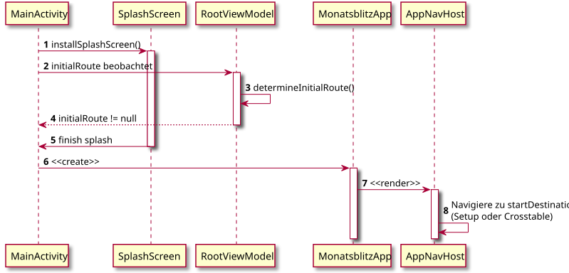
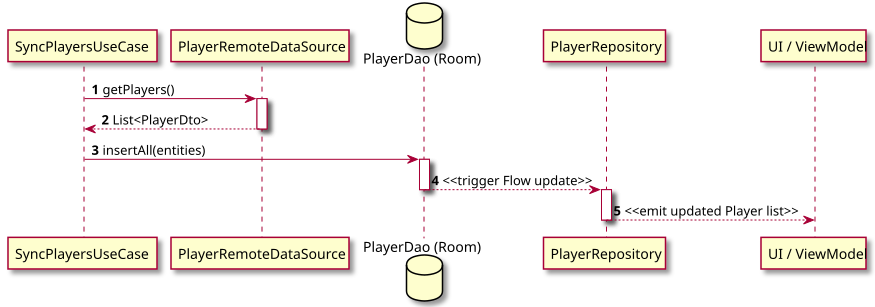
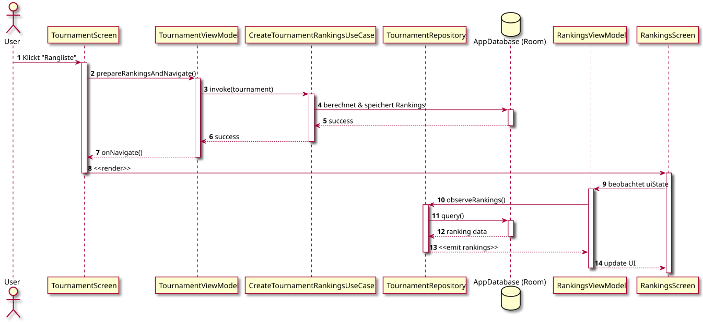

# 6. Laufzeitsicht

### 6.1 Navigation und Turnierstart
Der standardisierte Navigationsfluss via Jetpack Navigation Component:



### 6.2 Synchronisation mit REST-API
Der Sync-Prozess befüllt die lokale SSoT (Datenbank), ohne dass die UI direkt mit der API kommuniziert.



### 6.3 Ergebniseingabe und Ranking-Aktualisierung
Der Prozess der Ranking-Aktualisierung folgt einem unidirektionalen Fluss über die Datenbank.



### 6.4 Automatischer Live-Sync & Manueller Abgleich

Der Ablauf bei einer Ergebniseingabe verbindet verzögerungsfreie lokale Persistenz mit sicherem Hintergrund-Sync:

```
[User]
   │
   │ 1. Ergebnis wählen (1, ½, 0, +, -)
   ▼
[ResultCell / CrosstableScreen]
   │
   │ 2. setResult(...)
   ▼
[CrosstableViewModel]
   │
   ├────────────────────────────────────────────────┐
   │ (sofort, synchron zur UI)                      │ (asynchron in viewModelScope)
   ▼                                                ▼
[SetGameResultUseCase]                     [TournamentSyncManager]
   │                                                │
   │ 3. Partiestand lokal speichern                 │ 4. triggerSync()
   ▼    (dirty = 1)                                 │    syncStatus = SYNCING
[Room DB: games]                                    │
   │                                                ├─► SyncPlayersUseCase (neue Spieler remote anlegen)
   │ (Flow emittiert sofort neues UI-State)         ├─► SyncTournamentUseCase (Turnier remote anlegen)
   ▼                                                ├─► SyncGameResultsUseCase (POST /game Batch)
[UI: Kreuztabelle aktualisiert + Dirty-Punkt]       │
                                                    ▼
                                            [WordPress REST API]
                                                    │
                                           ┌────────┴────────┐
                                           │ Erfolg          │ Fehler / Offline
                                           ▼                 ▼
                                    [GameDao]          [SyncManager]
                                    dirty = 0          dirty = 1 bleibt erhalten
                                    syncStatus=SYNCED  syncStatus=FAILED
                                           │                 │
                                           ▼                 ▼
                                    [UI: CloudDone]    [UI: SyncProblem Icon]
                                                             │
                                                             │ Tippen auf Icon
                                                             ▼
                                                       [triggerManualSync()]
```

